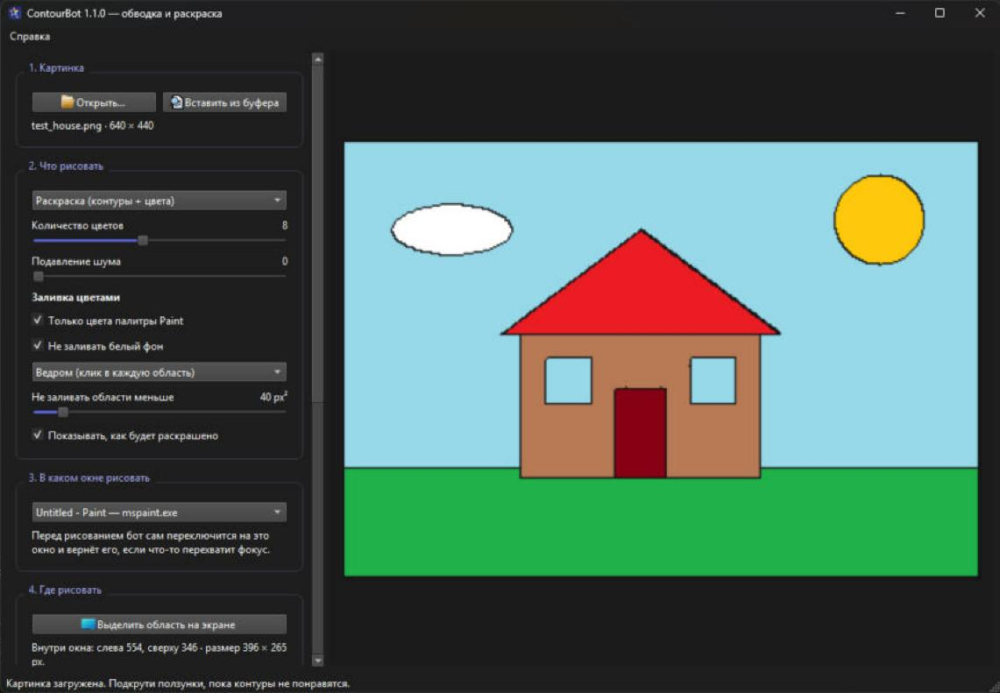
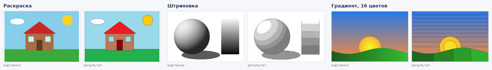
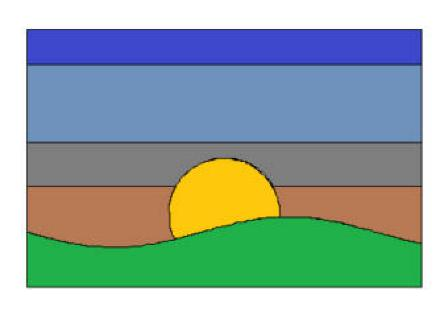

<p align="center">
  
</p>

<h1 align="center">ContourBot</h1>

<p align="center">
  Бот, который сам рисует мышкой в Paint: обводит картинку, штрихует тени и раскрашивает по цветам.<br>
  <i>A Windows bot that redraws a picture with the mouse cursor in Paint (or any drawing app): outlines, shading and colour fill.</i>
</p>

<p align="center">
  
</p>

> **Это игрушка.** ContourBot навайбкожен автором (**VKM**) вместе с Claude (Anthropic),
> просто чтобы поиграться с программами, в которых можно рисовать. Работает, но без гарантий.

## Что умеет

| Режим | Что делает |
|---|---|
| **Контуры** | Находит очертания на картинке и обводит их курсором. Два способа поиска: по резким перепадам яркости или по границам цветов. |
| **Штриховка (тени)** | Штрихует тёмные места. Чем темнее, тем больше слоёв штрихов под разными углами: светлые места остаются чистыми, тени — плотной сеткой. |
| **Контуры + штриховка** | Сначала обводит, потом кладёт тени. |
| **Раскраска** | Обводит границы цветовых областей, а потом по очереди показывает каждый цвет: где он в палитре Paint, его HEX и RGB. Выбираешь цвет, жмёшь F8 — бот заливает все области этого цвета ведром (или штрихами, если ведра нет). |

<p align="center">
  
</p>
<p align="center"><sub>Результаты посчитаны тем же кодом, что и в боте; заливка ведром здесь сымитирована.</sub></p>

А так выглядит закат, который бот обвёл и залил ведром в настоящем Paint по подсказкам панели:

<p align="center">
  
</p>

Ещё он умеет:

- **сам переключаться на нужное окно** — выбираешь Paint в списке открытых окон, и бот выводит его вперёд перед каждым штрихом, даже если что-то перехватило фокус;
- **выделять область прямо на экране** — область привязывается к окну и переезжает вместе с ним;
- **проверять настройку** — «Проверить рамку» обводит область курсором без нажатия, «Пробный штрих» рисует квадратик;
- **останавливаться** по клавише (по умолчанию Esc) или если сдвинуть мышь рукой;
- **подсказывать про права** — если окно запущено от администратора, Windows не пропускает в него клики, и бот предлагает перезапуститься от администратора;
- **запоминать все настройки** между запусками.

## Как пользоваться

1. **Открой картинку** — кнопкой, перетаскиванием в окно или Ctrl+V.
2. **Выбери режим** и подкрути ползунки — превью справа обновляется сразу.
3. **Выбери окно** (например, «Untitled - Paint») и **выдели область** на холсте.
4. В Paint возьми **карандаш** и цвет, нажми **F8**.
5. В режиме раскраски после контура появится панель с первым цветом: выбери его в палитре, возьми **ведро** и снова нажми **F8**. И так для каждого цвета.

| Клавиша | Действие |
|---|---|
| F8 | начать рисовать / залить текущий цвет (можно поменять) |
| Esc | остановить (можно поменять) |
| двинуть мышь | тоже остановить (можно выключить) |

### Советы

- Лучше всего получаются чёткие картинки: арты, логотипы, мультяшные рисунки. Фото дают много мелких линий.
- **Градиенты** в раскраске превращаются в полосы — у ведра один цвет на область. Больше цветов (до 16) — больше полос и плавнее переход. Для фото и градиентов красивее режим «Штриховка».
- «Только цвета палитры Paint» сводит картинку к 20 стандартным цветам — их не надо подбирать вручную. Без этой галочки цвета точные, но в Paint их придётся вводить через «Изменить цвета» → HEX (на панели есть кнопка «Скопировать HEX»).
- Если программа пропускает куски линий, увеличь «Паузу на точку» и уменьши «Шаг курсора».

## Скачать

Готовая сборка для Windows (x64) — на странице [Releases](../../releases). Распакуй архив и запусти `ContourBot.exe`.

## Сборка из исходников

Нужен Qt 6 (подойдёт и 5.15) и CMake. Сторонних библиотек нет — только Qt и WinAPI.

**Qt Creator:** File → Open File or Project → `CMakeLists.txt` → выбрать набор Desktop Qt (MinGW или MSVC) → Ctrl+B.

**Консоль:**

```bash
cmake -S . -B build -DCMAKE_PREFIX_PATH=C:/Qt/6.11.1/mingw_64
cmake --build build --config Release
windeployqt build/ContourBot.exe
```

Автосборка для GitHub Actions лежит в `.github/workflows/build.yml`: GitHub собирает exe на каждый push,
а на тег `v*` сам прикрепляет zip к релизу.

## Как это устроено

| Файл | Что внутри |
|---|---|
| `contours.cpp` | поиск контуров (Canny, k-means по цветам), трассировка линий, штриховка, раскраска и палитра Paint |
| `drawer.cpp` | поток, который водит мышью через `SendInput`, кликает ведром и следит за фокусом |
| `winutil.cpp` | список окон, принудительное переключение, проверка прав администратора |
| `areaselector.cpp` | выделение области поверх снимка экрана |
| `colorpanel.cpp` | плавающая панель с подсказкой цвета |
| `mainwindow.cpp` | интерфейс и пошаговая раскраска |

## Ограничения

- Только Windows: управление мышью и горячие клавиши сделаны на WinAPI.
- Заливка ведром рассчитана на рисовалки с 4-связной заливкой (как Paint). Очень мелкие области бот не заливает — их можно докрасить вручную.
- Программы, запущенные от администратора (часть игр), принимают клики только от программ с такими же правами.

## Лицензия

[GNU GPL 3.0](LICENSE). Автор — **VKM**, код написан вместе с Claude (Anthropic).
Использует [Qt](https://www.qt.io/) по лицензии LGPL 3.
